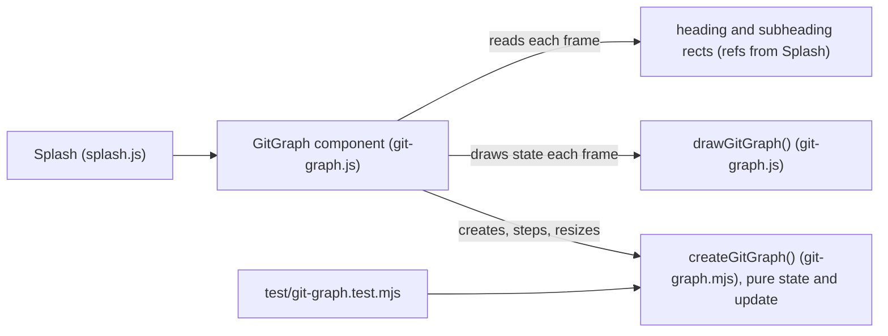
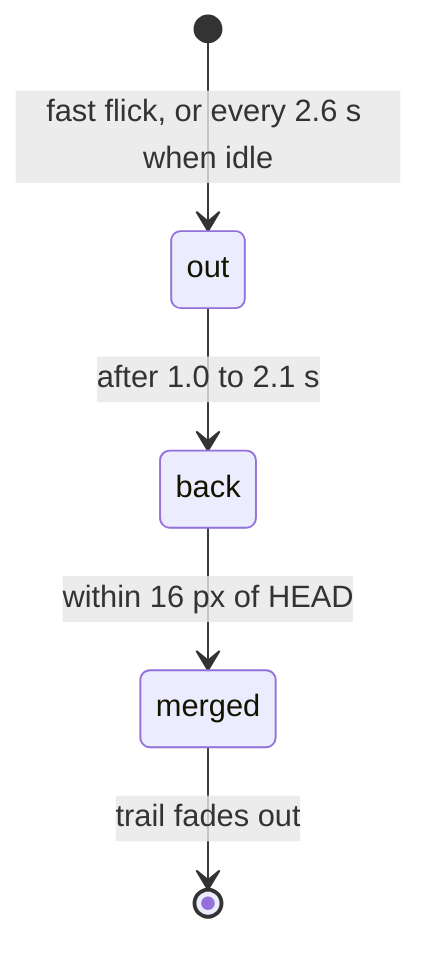

# Replace the homepage particles with an interactive git graph

*   **Author:** Erik Saulnier
*   **Status:** Implemented
*   **Date:** 2026-11-20

## At a glance

- **Subject:** the homepage splash background, now a tsParticles network, becomes a git graph that the visitor draws with the mouse.
- **Pick:** "Git v2 (polished)" from the prototype at [git-graph-splash-prototype.html](git-graph-splash-prototype.html), tab 2. It is one plain canvas 2D component with no new dependencies, and two tsParticles packages are removed.
- **Size:** a small change, about half a day. It touches `components/splash/` and adds one module and one test file. It also damps the heading entry spring, which jitters today.
- **Open:** nothing blocks the build. The calls the builder made are marked *(builder's call)* so the owner can check them.
- **Decision:** approved by the owner on 2026-11-20. The implementation plan follows.

## Intent

The current particle network looks good but feels random, and it has nothing to do with the owner's work. The owner wants something fun to play with using the mouse, tied to programming. A cloud of tech-stack icons was considered and rejected as boring.

Prototype rounds tried an ASCII code lens, circuit traces, an ASCII donut and a structured lane graph. The owner picked the free-drawn git graph: the cursor is `HEAD` on `main`, a fast flick forks a branch, and branches wander off and merge back.

## Goals, non-goals and anti-goals

**Goals**

- The visitor draws `main` with the mouse. A flick forks a named branch, a click makes a commit with a joke message, and branches merge back by themselves.
- The graph reads as a quiet background until someone touches it, and it MUST NOT compete with the heading.
- The motion is smooth at 60 fps on an ordinary laptop. It stays correct after a hidden tab, a page change or a resize.

**Non-goals**

- No change to the typed words, the header, the footer or the page transitions.
- No WebGL, and no new runtime dependency.

**Anti-goals.** The change fails, even if it works, when any of these is true:

- The heading is hard to read over the graph.
- The graph jumps, speeds up or snaps when the visitor comes back to the tab or the page.
- The trail looks jittery or scribbled. The owner rejected an earlier, sharper version as "pretty ugly".

## Constraints

- Next.js 13.3.1 on the Pages Router, built as a static export for Cloudflare. The canvas MUST start only on the client, inside `useEffect`.
- The splash sits inside `main.content`, the rounded `$dark-2` card in `components/layout`. The effect fills that card, not the window.
- Biome lints the build (`biome ci .`). Tests run with `node --test` on `test/*.test.mjs`. A module that the tests import MUST be `.mjs`, because the package has no `"type": "module"`.
- Framer Motion's `AnimatePresence` unmounts the page after its exit animation, so the animation loop MUST stop on unmount.

## Approaches

| Approach | Trade-off | Verdict |
|---|---|---|
| Plain canvas 2D component, with the motion logic in a pure `.mjs` module | No dependency. The logic is testable under `node --test`. The prototype ran at about 3 ms of CPU per frame without a GPU. | **Picked** |
| A tsParticles plugin | It keeps the library's bundle and fights its particle model, because branches are paths, not particles. | Rejected |
| A WebGL library such as Pixi | It adds a dependency to fix a speed problem the effect does not have. | Rejected |

## Design

### Parts

- `components/splash/git-graph.mjs` holds the state and the update step. It has no DOM, React or canvas access. Its inputs are the frame delta, the pointer state, the card size and a random source, so tests can drive it deterministically.
- `components/splash/git-graph.js` is the React component. It owns the `<canvas>`, the `requestAnimationFrame` loop, the pointer listeners, a `ResizeObserver` on the card and the drawing code.
- `components/splash/splash.js` drops `Particles`, renders `<GitGraph>` in its place, and passes refs to the heading and the subheading for the clear zone.
- Removed: `react-tsparticles`, `tsparticles-slim` and `components/splash/particlesjs-config.json`.
- `splash.module.scss` changes the splash background from `$primary-dark` to transparent, so the dark card shows through. The owner chose the dark card over the blue.

### Branch lifecycle

- **out:** the branch starts at the flick velocity × 0.4, capped at 600 px/s. It wanders, and its speed eases toward 220 px/s.
- **back:** the branch steers toward `HEAD`. Its speed rises with time in this state and MUST be capped at 1,400 px/s. The cap and the simulation clock below together prevent the hidden-tab speed-up.
- **merged:** `main` gets a merge commit filled with the branch color, and the text "Merge '<name>'" floats up and fades.
- At most 5 branches live at once, and forks are at least 450 ms apart.

### Behavior the prototype settled

The prototype file is the reference for every value. These are the ones that matter:

- **HEAD motion.** `HEAD` follows its target through a critically damped spring (ω = 9), so it eases in without overshooting. With the mouse in the card, the target is the pointer.
- **Idle and leaving.** When the pointer has been still for 2.5 s or leaves the card, the target becomes a wanderer that starts at `HEAD`'s position and heading. It moves at 120 px/s, turns gently and steers away from a 90 px margin. `main` MUST continue from where the visitor left it and MUST NOT jump to another path.
- **Trail.** `main` adds a point every 4 px and a commit every 90 px. Points and commits fade over 6 s. Each path is drawn as quadratic curves through the midpoints of its points, in two passes: a 7 px glow at alpha 0.07 and a 1.75 px line at alpha 0.8.
- **Softness.** Every draw is multiplied by `0.5 + 0.5 × activity`. Activity rises toward 1 while the pointer moves and decays slowly to 0.
- **Text.** Hashes on `main` commits fade over 2 s. Branch names sit at each live branch's head, and the label `HEAD -> main` follows `HEAD`. Click commits show a hash and a random joke message. The six branch colors stay.
- **Clear zone.** A soft elliptical gradient erases about 80% of the graph behind the heading and the subheading, read from their rects every frame, because the typed subheading changes width.

### Time and lifecycle

- **Simulation clock.** Every age, fade and timer uses a clock that only advances by the clamped frame delta (at most 50 ms). The wall clock MUST NOT reach the simulation. This fixes the bug the owner found in the prototype, where branches charged off after a tab switch.
- **Hidden tab.** On `visibilitychange` back to visible, the loop resets its last timestamp, so the first frame is one normal step.
- **Page change.** On unmount, the component cancels the frame, disconnects the observer and removes its listeners. Coming back to the homepage starts a fresh, empty graph.
- **Resize.** The card size feeds the simulation. The canvas backing size is `size × devicePixelRatio`, capped at 2. State is kept across a resize.

### Heading entry

The heading letters and the subheading use `{ type: 'spring', stiffness: 300 }` with Framer Motion's default damping of 10. That gives a damping ratio of about 0.29. Measured in the dev server, each letter overshoots from +15 px to −5.2 px, swings to +2.1 px and then to −0.8 px. Its horizontal scale wobbles 1.07 → 0.97 → 1.01 over about 600 ms, and then it snaps to rest. The owner sees this as jitter.

- Both springs MUST set `damping: 26`, a damping ratio of about 0.75. The letter then settles with less than 0.5 px of overshoot and does not swing back.
- The stagger (0.1 s per letter), the start offsets (`y: 15`, `scaleX: 0.8`) and the subheading delay stay as they are.
- The check: sample the first letter's transform on every frame, as the measurement above did. The translate MUST NOT change sign more than once.

### Calls the builder made

- *(builder's call)* With `prefers-reduced-motion: reduce`, the idle wanderer and its automatic forks are off. The graph moves only while the visitor moves the pointer. The fade-outs stay.
- *(builder's call)* Touch uses the same pointer events: dragging draws, and a tap commits. On a phone the idle wanderer runs, so the card is not empty.
- *(builder's call)* The canvas is `aria-hidden="true"` and is decoration only. The heading stays the accessible content.
- *(builder's call)* Branch names, commit messages and colors are constants in `git-graph.mjs`. They do not go into Keystatic content.

## Testing

`test/git-graph.test.mjs` drives the pure module with a seeded random source:

- After a simulated hidden gap, the clamped frame step keeps every branch speed at or below the cap.
- When the pointer goes idle, `HEAD`'s next target starts at its last position. No jump larger than one frame of motion occurs.
- Branches reach `merged`, and the live count never goes above 5.
- Points and commits older than 6 simulated seconds are removed.

The owner checks the look by hand in the dev server. The checklist: the trail is smooth, the heading is clear, the graph continues where it was after a tab switch, and it starts fresh after a page change.

## Left to the builder

- Splitting the drawing code into helpers, and naming them.
- Whether the random source is injected as a function or as a seed.
- The exact clear-zone padding, as long as the heading stays readable at every breakpoint.
